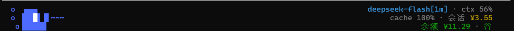

# deepseek-whale

给 Claude Code **终端 CLI** 用的三行状态栏。左边是手绘的 DeepSeek 小鲸鱼，右边显示模型、上下文、缓存命中率、本次会话费用、账户余额，以及当前是峰价还是谷价。



> 鲸鱼是作者自己画的，不好看请见谅~

## 功能

- **三行状态栏**：左侧 3 行鲸鱼，右侧信息右对齐，位于终端右下角。
- **真实 DeepSeek 费用**：读取主 transcript 和子代理 transcript，按每条请求发生时的峰/谷价计算；不使用 Claude Code 的 Claude 价格估算。
- **峰/谷指示**：`峰` 表示高峰价，`谷` 表示空闲价，显示在余额后面。
- **账户余额**：请求 `GET https://api.deepseek.com/user/balance`，60 秒缓存，后台子进程刷新，不阻塞状态栏。
- **缓存和上下文**：`cache` 显示 prompt cache 命中率，`ctx` 显示上下文窗口占用。
- **逐格颜色**：`whaleColors` 支持每个格子单独配色；默认图案就是截图里的鲸鱼。
- **零依赖**：一个 Node 脚本，不需要 npm 包。

## 环境要求

- Claude Code 2.1.x 或更新版本（支持多行 statusLine）。
- Node.js 18 或更新版本。
- 想显示余额需要 DeepSeek API Key：优先 `DEEPSEEK_API_KEY`，其次 `config.json` 里的 `apiKey`，最后在 `ANTHROPIC_BASE_URL` 指向 `api.deepseek.com` 时使用 `ANTHROPIC_AUTH_TOKEN`。
- 余额接口只在 `api.deepseek.com` 上可用；第三方中转需要自己设置 `balance.url`，或者关闭余额。
- 只支持 Claude Code 终端 CLI；桌面版和 IDE 扩展不渲染自定义状态栏。

## 插件安装

```bash
/plugin install deepseek-whale --marketplace Wasabi2575/cc-deepseek-statusline
/deepseek-whale:setup
```

如果鲸鱼没有马上出现，重启 Claude Code。setup 会：

- 把 `statusline.js` 复制到 `~/.claude/deepseek-whale/`
- 写入默认 `config.json`（已存在则不覆盖）
- 备份 `~/.claude/settings.json`
- 添加 `statusLine` 配置

命令行安装：

```bash
claude plugin install deepseek-whale --marketplace Wasabi2575/cc-deepseek-statusline
```

## 手动安装

```bash
git clone https://github.com/Wasabi2575/cc-deepseek-statusline.git
cd cc-deepseek-statusline
node scripts/setup.js
```

预览（不修改设置）：

```bash
node scripts/statusline.js --demo
```

查看会写入什么：

```bash
node scripts/setup.js --dry-run
```

## 配置

编辑 `~/.claude/deepseek-whale/config.json`：

```json
{
  "whale": true,
  "widthMargin": 6,
  "infoAlign": "right",
  "infoSeparator": " · ",
  "costCurrency": "CNY",
  "whaleArt": [
    "o  ▄▄▄      ",
    "o ▐███▌▐▌~~~",
    " o▐█████    "
  ],
  "whaleColors": [
    ["#4d6bfe", null, null, "#4d6bfe", "#4d6bfe", "#4d6bfe", null, null, null, null, null, null],
    ["#4d6bfe", null, "#4d6bfe", "#4d6bfe", "#4d6bfe", "#ffffff", "#4d6bfe", "#4d6bfe", "#4d6bfe", "#4d6bfe", "#4d6bfe", "#4d6bfe"],
    [null, "#4d6bfe", "#4d6bfe", "#4d6bfe", "#4d6bfe", "#4d6bfe", "#4d6bfe", "#4d6bfe", null, null, null, null]
  ],
  "whaleColor": "#4D6BFE",
  "whaleAccentColor": "#96B4FF",
  "whaleEyeColor": "#FFFFFF",
  "labels": {
    "session": "会话",
    "balance": "余额",
    "peak": "峰",
    "offPeak": "谷"
  },
  "balance": {
    "enabled": true,
    "url": "https://api.deepseek.com/user/balance",
    "refreshSeconds": 60,
    "timeoutMs": 2500
  },
  "pricing": {
    "deepseek-flash": {
      "peak":    { "input": 0.30, "output": 1.20, "cacheRead": 0.006, "cacheWrite": 0.30 },
      "offPeak": { "input": 0.15, "output": 0.60, "cacheRead": 0.003, "cacheWrite": 0.15 }
    },
    "deepseek-v4-pro": {
      "peak":    { "input": 1.32, "output": 3.96, "cacheRead": 0.044, "cacheWrite": 1.32 },
      "offPeak": { "input": 0.66, "output": 1.98, "cacheRead": 0.022, "cacheWrite": 0.66 }
    }
  },
  "pricingCny": {
    "deepseek-flash": {
      "peak":    { "input": 2, "output": 8, "cacheRead": 0.04, "cacheWrite": 2 },
      "offPeak": { "input": 1, "output": 4, "cacheRead": 0.02, "cacheWrite": 1 }
    },
    "deepseek-v4-pro": {
      "peak":    { "input": 9, "output": 27, "cacheRead": 0.30, "cacheWrite": 9 },
      "offPeak": { "input": 4.5, "output": 13.5, "cacheRead": 0.15, "cacheWrite": 4.5 }
    }
  },
  "holidays": []
}
```

### 配置说明

- `infoAlign`：`"right"` 右边缘对齐，`"left"` 左边缘对齐。右对齐时三行长度不同，左边起点会参差，这是正常的。
- `widthMargin`：右边距，默认 `6`。如果状态栏右边被截断或出现 `…`，可以调大（8/10/12）。
- `costCurrency`：`"CNY"` 使用 `pricingCny` 并显示 `¥`；`"USD"` 使用 `pricing` 并显示 `$`。余额货币由余额接口返回的 `currency` 决定。
- `pricing`：美元 / 百万 token；`pricingCny`：人民币 / 百万 token。DeepSeek 调价时两个表都要更新。
- `cacheWrite`：只有当接口返回 `cache_creation_input_tokens` 时才有意义；DeepSeek 自动缓存通常返回 `0`。
- `holidays`：中国法定节假日的 `YYYY-MM-DD`（北京时间），这些工作日按谷价计算。
- `whaleArt` / `whaleColors`：三行图案和可选的逐格颜色。空格透明；没有指定颜色的格子回退到 `whaleColor` / `whaleAccentColor` / `whaleEyeColor`。
- `balance.enabled`：设为 `false` 可关闭余额请求，第三行只显示峰/谷。

### 余额 Key 的读取顺序

1. `DEEPSEEK_API_KEY`
2. `config.json` 里的 `apiKey`
3. `ANTHROPIC_AUTH_TOKEN`，但仅当 `ANTHROPIC_BASE_URL` 包含 `api.deepseek.com`

脚本不会把 Key 发送到非 DeepSeek 的余额地址，除非你自己设置了 `balance.url`。

## 费用怎么算

对主 transcript 和 `subagents/*.jsonl` 里的每条 `assistant` 记录：

```text
费用 = input_tokens        × 输入单价
     + output_tokens       × 输出单价
     + cache_read_tokens   × 缓存命中单价
     + cache_write_tokens  × 缓存写入单价
```

每条请求按它自己的时间戳选择峰价/谷价，然后累加；流式产生的重复 `message.id` 会去重，只保留最后一次 usage。结果按 transcript 的大小和修改时间缓存。

`会话` 显示的是**当前会话累计费用**：主对话 + 子代理里所有请求的总和，不是上一轮对话，也不是当前上下文窗口里那部分 token 的价格。`/clear` 或开新会话后归零。`ctx` 才是当前上下文窗口占用。

## 限制

- Claude Code 官方不支持把 CLI 接到非 Claude 模型；本插件按 transcript 数据计算，transcript 是内部格式，可能随版本变化。解析失败时会显示 `--`，不会给出错误数字。
- 子代理费用只覆盖 `<session-id>/subagents/` 下的 transcript；其他后台任务可能不计入。
- DeepSeek 余额接口不在第三方中转上；需要自定义 `balance.url` 或关闭余额。
- 价格和峰谷时段可能变化；默认值截至 2026 年 11 月。
- 不同终端对中文、`·`、`¥` 的宽度处理可能不同，右边缘可能偏 1 格；可以调 `widthMargin` 或改用 `infoAlign: "left"`。
- 本状态栏只适用于 Claude Code 终端 CLI。

## 卸载

```bash
node ~/.claude/deepseek-whale/uninstall.js
```

或者从仓库：

```bash
node scripts/uninstall.js --purge
```

卸载脚本只会删除指向 `deepseek-whale` 的 `statusLine` 配置；`--purge` 会同时删除 `~/.claude/deepseek-whale` 目录。

## License

MIT
